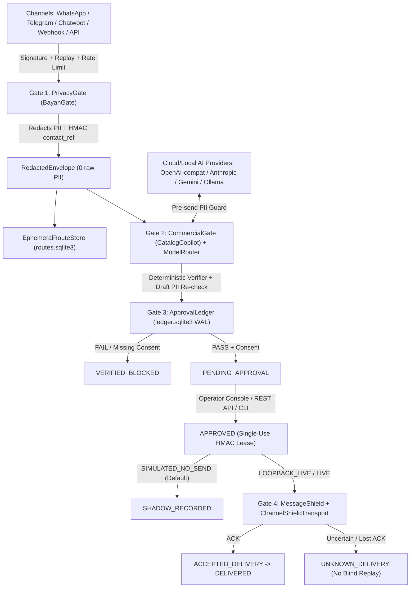

# TijaraGuard Architecture & Threat Model

## 1. Layered Product Architecture

TijaraGuard separates domain safety gates, AI provider routing, official messaging adapters, SQLite persistence, and the operator interface into independent modules:

## 2. Package & Module Boundaries

- `tijaraguard/deps.py`: Bytecode-safe dependency loader (`env_override -> sibling_repo -> vendored -> installed`) with SHA-256 `tijaraguard/_vendor/MANIFEST.json` verification.
- `tijaraguard/security.py`: SSRF validation (`validate_outbound_url`), constant-time HMAC/API-key verification, replay window validation, `SlidingWindowRateLimiter`, CSV formula neutralization, secret/PII log filtering, and POSIX permission hardening.
- `tijaraguard/config.py`: Dataclass configuration loader (`JSON + ENV`) and fail-closed startup validator.
- `tijaraguard/providers/`: `OpenAICompatibleProvider`, `AnthropicProvider`, `GeminiProvider`, `OllamaProvider`, `HardenedJSONHttpClient` (no redirects), and `ModelRouter` (complexity tier routing, pre-send PII guard, observable fallback, usage accounting).
- `tijaraguard/channels/`: `WhatsAppCloudAdapter`, `TelegramBotAdapter`, `ChatwootAdapter`, `GenericWebhookAdapter`, `ChannelShieldTransport`, and `ChannelRegistry`.
- `tijaraguard/privacy.py` & `tijaraguard/commerce.py`: Gate 1 (`BayanGate`) and Gate 2 (`CatalogCopilot`) adapters.
- `tijaraguard/ledger.py`: Schema v2 SQLite WAL ledger (`drafts`, `approvals`, `audit_events`, `channel_events`, `provider_usage`, `schema_migrations`), safe v1->v2 migration, hot backup/restore, retention purge, and separate `EphemeralRouteStore`.
- `tijaraguard/pipeline.py` & `tijaraguard/runtime.py`: End-to-end 4-gate orchestration and dependency injection.
- `tijaraguard/api.py`, `tijaraguard/web/index.html`, `tijaraguard/cli.py`: Authenticated REST API, webhook endpoints, lightweight RTL/LTR operator dashboard, and full CLI.

## 3. Honesty & Verification Boundaries

- Automated tests verify all AI providers and messaging channels against real local `ThreadingHTTPServer` protocol endpoints using synthetic data only.
- Live external API calls (OpenAI, Anthropic, Gemini, Meta WhatsApp Cloud, Telegram Bot API, live Chatwoot servers) require real operator credentials and remain `NOT_TESTED` in this offline/sandboxed environment.
