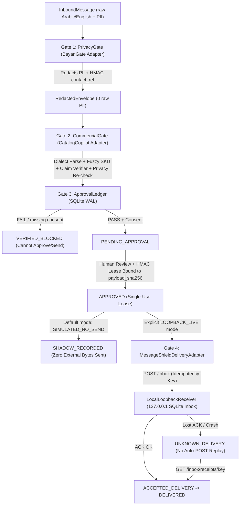

# TijaraGuard Architecture & Threat Model

## 1. System Architecture

TijaraGuard wraps three unmodified, read-only sibling repositories (`BayanGate`, `CatalogCopilot`, `MessageShield`) behind narrow Python adapters orchestrated by `TijaraGuardPipeline` ([tijaraguard/pipeline.py](tijaraguard/pipeline.py)):

## 2. Read-Only Dependency Boundaries

- `tijaraguard/deps.py` sets `sys.dont_write_bytecode = True` before adding sibling repositories to `sys.path`, guaranteeing zero `.pyc` or `__pycache__` writes inside `bayan-gate`, `catalog-copilot`, or `message-shield`.
- **Gate 1 ([tijaraguard/privacy.py](tijaraguard/privacy.py))**:
  - Uses `RegionalPIIEngine` and `PIIRedactor`.
  - Strips sensitive subfields (`formatted_iban`, `clean_number`) from `RedactionResult.to_dict(include_raw_spans=False)` via a strict `_SAFE_METADATA_KEYS` allowlist before storing `pii_summary_json` in SQLite.
  - Replaces `raw_contact_target` with an irreversible keyed digest `ref-<16hex>`.
  - Re-scans redacted outputs and outbound drafts for residual supported PII.
- **Gate 2 ([tijaraguard/commerce.py](tijaraguard/commerce.py))**:
  - Removes Gate 1 redaction placeholder tags before running `parse_dialectal_inquiry` and `FuzzyCatalogMatcher` so masked spans do not degrade Arabic product resolution.
  - Binds `LeadInquiry` with `contact_channel="chat"` and `contact_target=envelope.contact_ref` so raw phone/email values never enter `CatalogCopilot`.
  - Verifies drafts with `CommercialClaimVerifier` and re-checks privacy (`PRIVACY_LEAK_IN_DRAFT`).
- **Gate 3 ([tijaraguard/ledger.py](tijaraguard/ledger.py))**:
  - Uses SQLite WAL mode, `PRAGMA foreign_keys=ON`, `PRAGMA synchronous=FULL`, and `BEGIN IMMEDIATE` on all mutating transactions.
  - Canonical payload binding (`compute_draft_payload_sha256` with `allow_nan=False`, `sort_keys=True`) prevents post-approval modification.
  - HMAC-SHA256 `ApprovalToken` leases are single-use (`UPDATE approvals SET consumed=1 ... WHERE consumed=0 AND revoked=0`), time-bounded (`expires_at`), and revoked automatically upon `edit_draft` or detected payload/MAC mismatch (`APPROVAL_INVALIDATED_TAMPER`).
  - `audit_events` enforces SQLite `BEFORE UPDATE` and `BEFORE DELETE` abort triggers and maintains a SHA-256 `prev_hash -> event_hash` chain verified via `verify_audit_chain()`.
- **Gate 4 ([tijaraguard/delivery.py](tijaraguard/delivery.py))**:
  - Uses `MessageShield` `Shield` (`admit`, `send`, `recover`, `receipt`, `get`).
  - Rejects any endpoint outside literal loopback (`127.0.0.1`, `::1`).
  - `LocalLoopbackReceiver` commits deduplicated rows into SQLite `inbox(key PRIMARY KEY, ...)` before replying HTTP 200 or injecting `drop_ack` connection shutdown.

## 3. Threat Model & Mitigations

| Threat | Mitigation | Verification |
| --- | --- | --- |
| Raw PII leaked in SQLite, logs, or exceptions | BayanGate pre-persistence redaction, metadata allowlist scrubbing, opaque `contact_ref`, PII-free exceptions | `test_gate1_privacy.py` & `audit_zero_pii()` |
| LLM price/discount/warranty/stock hallucinations | Deterministic `CommercialClaimVerifier` whitelist + consent & expiry enforcement | `test_gate2_commerce.py` |
| Bypassing human review or unsolicited messaging | Shadow Mode default (`SIMULATED_NO_SEND`), strict consent parser (`"false"` -> `False`), `PENDING_APPROVAL` gating | `test_gate2_commerce.py` & `test_gate3_approval.py` |
| Post-approval payload tampering or token replay | Canonical SHA-256 + HMAC-SHA256 lease check, atomic `consumed=0 -> 1` SQL update, tamper revocation | `test_gate3_approval.py` |
| Audit log tampering | `audit_events` SQLite triggers (`RAISE(ABORT)`) + SHA-256 hash chain verification | `test_gate3_approval.py` & `verify-audit` |
| Duplicate customer delivery after lost ACK or crash | `MessageShield` `UNKNOWN` state prevents blind POST replay; read-only `GET /inbox/receipts/<key>` recovery + SQLite `PRIMARY KEY(key)` inbox | `test_gate4_delivery.py` |
| SSRF / accidental live external messaging | Shadow default + literal loopback restriction (`127.0.0.1` / `::1`) | `test_gate4_delivery.py` |

## 4. Residual Limitations & Non-Claims

1. Not a production multi-tenant server or public HTTP API (no TLS termination, key rotation, or encryption-at-rest).
2. Does NOT guarantee universal exactly-once delivery on arbitrary remote gateways (requires receiver idempotency and truthful receipt readback).
3. Does NOT redact unstructured free-text Arabic person names or dates of birth (`UNSUPPORTED_ENTITY_TYPES` in `BayanGate`).
4. Does NOT call external LLMs, WhatsApp Business APIs, Chatwoot servers, or remote hosts.
